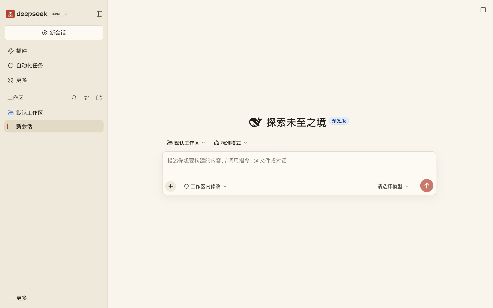
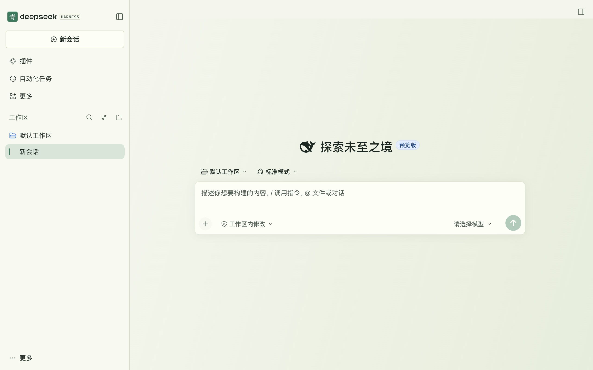
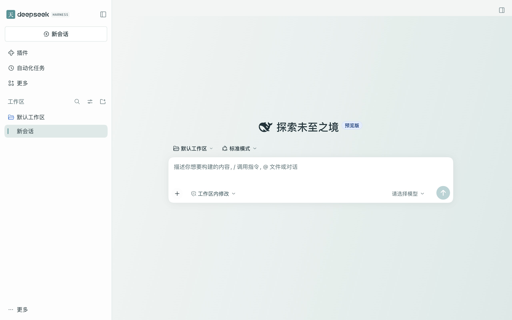
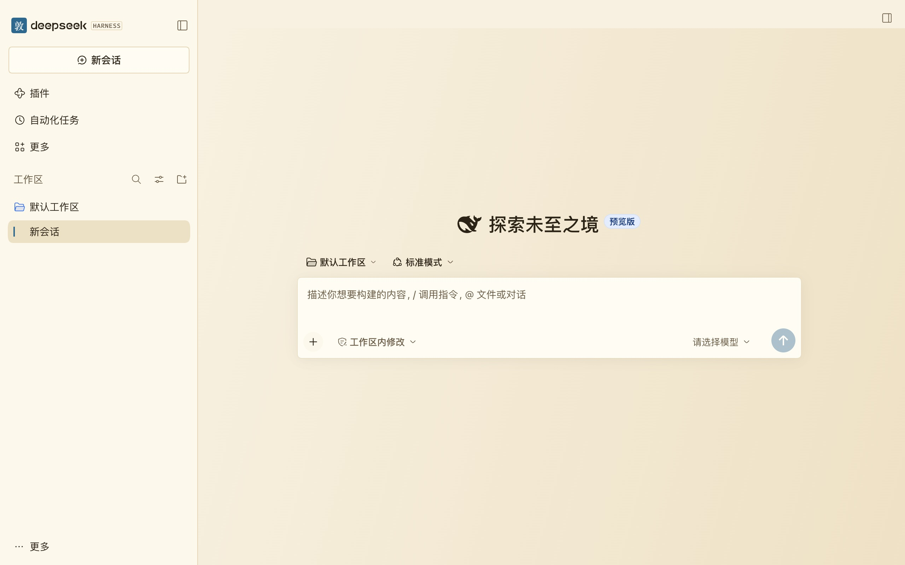
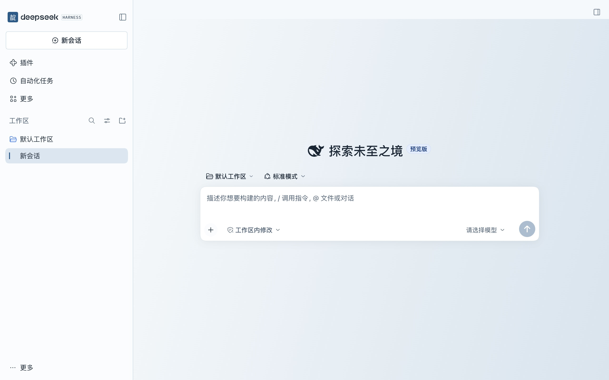

# DeepSeek Harness 中国风皮肤

一个 Cordis 插件内置墨竹、青绿、天青、敦煌、靛蓝五套亮色皮肤。首次启用默认墨竹，进入「设置 → 中国风皮肤」即可切换或选择「官方外观」。选择保存在当前客户端的本地存储。

## 皮肤实拍

以下截图来自 DeepSeek Harness 的新会话页面。点击图片可查看原尺寸。

### 墨竹

[](docs/screenshots/mozhu.jpg)

### 青绿

[](docs/screenshots/qinglv.jpg)

### 天青

[](docs/screenshots/tianqing.jpg)

### 敦煌

[](docs/screenshots/dunhuang.jpg)

### 靛蓝

[](docs/screenshots/dianlan.jpg)

## 桌面版安装

已在 macOS 上的 DeepSeek Harness `0.2.2-rc.1` 验证。先打开过一次桌面版以初始化配置，并确认终端可运行 `dsh --version`。

下载 [v0.1.16 安装包](https://github.com/aoe1124/dsh-chinese-skin/releases/download/v0.1.16/dsh-chinese-skin-0.1.16.tgz)。完全退出 DeepSeek Harness，在安装包所在目录执行下面的命令，然后重新打开应用。

```sh
dsh plugin --profile desktop add ./dsh-chinese-skin-0.1.16.tgz
```

在「设置 → 中国风皮肤」里切换皮肤。

多套换肤插件可能同时覆盖同一组宿主颜色。使用本插件时建议在插件管理页停用其他换肤插件。

## 从源码构建

```sh
npm ci
mkdir -p dist
npm test
npm pack --pack-destination dist
```

生成的 `.tgz` 包含构建好的客户端，可按上面的方式安装。

## 卸载

完全退出 DeepSeek Harness 后运行以下命令。

```sh
dsh plugin --profile desktop remove dsh-chinese-skin
```

重新打开 DeepSeek Harness 后恢复宿主外观。
